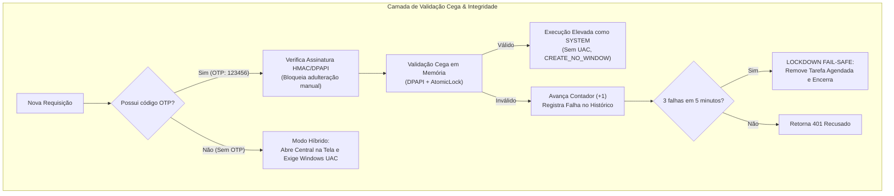

# Antigravity Admin Bridge & HOTP Security System

[](LICENSE)
[](https://microsoft.com)
[-brightgreen.svg)](https://datatracker.ietf.org/doc/html/rfc4226)

Bridge administrativo autônomo com aprovação *Human-in-the-Loop*, autenticação por código de uso único baseado em contador (**HOTP - RFC 4226**), modelo de **validação cega**, isolamento estrito de memória, proteção de privilégios nativa no Windows e isolamento NTFS exclusivo para a conta `SYSTEM`.

Projetado especialmente para permitir que agentes de IA e desenvolvedores executem tarefas administrativas com total segurança, rastreabilidade e sem concessão de acesso irrestrito.

---

## 📑 Sumário

- [Visão Geral](#-visão-geral)
- [Princípios de Segurança](#-princípios-de-segurança)
- [Isolamento NTFS Exclusivo para SYSTEM](#-isolamento-ntfs-exclusivo-para-system)
- [Central de Gestão na Bandeja do Sistema (System Tray & Dashboard)](#-central-de-gestão-na-bandeja-do-sistema-system-tray--dashboard)
- [Mecanismo Estrito de Reset (Autodestruição de Privilégios)](#-mecanismo-estrito-de-reset-autodestruição-de-privilégios)
- [Rotina Completa de Desinstalação](#-rotina-completa-de-desinstalação)
- [Operação via CLI (Linha de Comando Integral)](#-operação-via-cli-linha-de-comando-integral)
- [Modo Híbrido de Execução](#-modo-híbrido-de-execução)
- [Como Compilar do Código-Fonte](#-como-compilar-do-código-fonte)
- [Licença](#-licença)

---

## 🎯 Visão Geral

O **Antigravity Admin Bridge** atua como uma barreira de segurança (*security gate*) entre um ambiente não-elevado (como o prompt do assistente de IA ou um terminal comum) e operações que demandam permissões de Administrador do Windows.

O sistema opera em formato **standalone (executável único)**:
- Não requer instalação prévia de Python nem dependências na máquina de destino.
- Auto-extrai os componentes necessários e configura o ambiente local em `C:\Utilitario`.
- Executa como serviço protegido em segundo plano via Agendador de Tarefas do Windows sob a conta `SYSTEM` (`/ru "SYSTEM" /rl HIGHEST`).
- Funciona de forma **100% intercambiável** tanto por **Interface Gráfica (GUI na Bandeja)** quanto por **Linha de Comando (CLI)**.

---

## 🛡️ Princípios de Segurança



### 1. Modelo de Validação Cega (Zero Display no Computador)
- O computador atua **exclusivamente como validador**. O código OTP nunca é calculado ou exibido no monitor, logs, atalhos ou menu da bandeja.
- A geração dos tokens de 6 dígitos ocorre **exclusivamente no celular** do usuário através de aplicativos autenticadores (**Aegis**, **2FAS** ou **Google Authenticator**).

### 2. Criptografia Modular e Higiene de Memória
- A chave secreta de 160 bits (`secret_dpapi`) e o hash PBKDF2 da senha de recuperação (`recovery_hash_dpapi`) são protegidos de forma isolada pela API criptográfica nativa do Windows (**DPAPI - CryptProtectData**).
- Os buffers de memória são destruídos e sobrescritos com zeros usando `ctypes.memset` imediatamente após o milissegundo da validação.
- O campo `counter` e os metadados de auditoria permitem **leitura passiva direta** para o Dashboard, sem que a chave secreta de 160 bits seja acedida ou desencriptada na memória RAM.

### 3. Assinatura de Integridade (Detecção de Adulteração Manual)
- O arquivo de configuração possui uma assinatura HMAC protegida por DPAPI (`integrity_mac`).
- Qualquer tentativa de editar o arquivo manualmente pelo Bloco de Notas ou script externo (por exemplo, forçando `counter: 0`, zerando `failures` ou alterando `lockdown`) invalida a assinatura, dispara `SecurityError` e bloqueia sumariamente qualquer execução.

---

## 🔒 Isolamento NTFS Exclusivo para SYSTEM

Conforme as diretrizes de endurecimento do sistema operacional:

- **Conta de Execução**: A tarefa agendada do Windows é registrada para executar estritamente sob o contexto da conta do sistema local:
  ```powershell
  schtasks /create /tn "AntigravityAdminBridge" /tr "C:\Utilitario\AntigravityBridge.exe --daemon" /rl HIGHEST /ru "SYSTEM" /sc ONSTART /f
  ```
- **Herança Desativada**: No diretório de configurações (`C:\Utilitario\config`) e seus arquivos de estado, a herança de permissões é desativada via `icacls` (`/inheritance:r`).
- **Acesso Exclusivo a SYSTEM**: Permissão de Controle Total `(F)` é concedida **exclusivamente** para `AUTORIDADE NT\SISTEMA` (`*S-1-5-18`).
- **Acesso Negado a Administradores e Usuários**: Tentativas de abrir a pasta pelo Explorador de Arquivos ou Bloco de Notas (mesmo executando como Administrador) retornam `"Acesso Negado"`.
- Apenas o processo `AntigravityBridge.exe` rodando como `SYSTEM` tem acesso direto de leitura e gravação às chaves protegidas.

---

## 🖥️ Central de Gestão na Bandeja do Sistema (System Tray & Dashboard)

Ao ser executado no ambiente de trabalho do usuário, o `AntigravityBridge.exe`:
1. **Inicializa minimizado na bandeja do sistema** ao lado do relógio do Windows, sem janelas de terminal visíveis.
2. Um clique com o botão esquerdo no ícone da bandeja abre a janela da **Central de Gestão**:

### Painel Superior (Métricas em Tempo Real)
- **Contador HOTP Atual**: Exibição direta do valor atual do contador (ex.: `Contador Atual: 4`).
- **Estado do Serviço**: Indicador visual (`● Ativo`, `● Bloqueado (Lockdown)` ou `● Aguardando Provisionamento`).
- **Disjuntor Fail-Safe**: Contador de falhas recentes na janela de 5 minutos (ex.: `0 / 3 Falhas`).

### Tabela de Histórico Recente & Auditoria
- Lista detalhada das últimas requisições obtidas de `logs/auth.log` e `queue/responses/`.
- Colunas:
  1. **Data/Hora**: Timestamp local formatado.
  2. **Comando / Operação**: Título ou ação executada.
  3. **Estado**: Badge visual verde (`Aprovado`) ou vermelho (`Rejeitado`).
  4. **OTP (Mascarado)**: Mantém estritamente apenas os 2 primeiros dígitos visíveis (ex.: `48****` ou `******`).

### Painel de Ações
- 🔄 **"Resetar HOTP (Revogar Privilégios)"**: Aciona o assistente de destruição de privilégios.
- 🗑️ **"Desinstalar Utilitário"**: Aciona a rotina de limpeza e remoção completa da máquina.
- 🔃 **"Recarregar Histórico"**: Atualiza instantaneamente a tabela e os cartões de métricas.
- ❌ **"Minimizar para a Bandeja"**: Oculta a janela mantendo o serviço monitorando requisições.

---

## 🔄 Mecanismo Estrito de Reset (Autodestruição de Privilégios)

Ao acionar a redefinição (seja pelo botão na Central ou via CLI com `AntigravityBridge.exe reset`):

1. A interface solicita a **Palavra-passe de Recuperação** e exibe um **Desafio de Presença Física** gerado dinamicamente na tela (`PHYS-XXXXXX`).
2. Validada a senha e o código de presença física:
   - A chave HOTP atual é **imediatamente destruída e apagada** da memória RAM e do disco (`hotp_config.json` tem `secret_dpapi = ""` e `provisioned_flag = 0`).
   - O utilitário remove de imediato a sua própria tarefa elevada no Windows:
     ```powershell
     schtasks /delete /tn AntigravityAdminBridge /f
     ```
   - O utilitário **perde todas as permissões administrativas permanentes** e encerra sua execução elevada.
   - Para voltar a configurar uma nova chave ou reativar o serviço elevado, é obrigatório passar novamente pela aprovação manual do **Windows UAC** (`-Verb RunAs`).

---

## 🗑️ Rotina Completa de Desinstalação

Ao acionar o botão **"Desinstalar Utilitário"** (ou via CLI com `AntigravityBridge.exe uninstall`):

1. Solicita confirmação explícita do usuário.
2. Desativa e remove a tarefa agendada do Windows (`schtasks /delete /f`).
3. Libera e encerra locks atômicos (Named Mutex e arquivos `.lock`).
4. Utiliza `takeown` e `icacls` para assumir a posse e restaurar permissões completas na pasta `C:\Utilitario`.
5. Elimina os atalhos criados na Área de Trabalho (`Configurar Antigravity Bridge.lnk`).
6. Remove completamente as filas (`queue/`), logs e arquivos de `C:\Utilitario`.
7. Conclui com mensagem visual ou texto confirmando a desinstalação.

---

## ⌨️ Operação via CLI (Linha de Comando Integral)

O executável standalone `AntigravityBridge.exe` funciona integralmente via terminal de comandos:

### 1. Provisionamento Inicial 100% via Linha de Comando (Zero Janelas Gráficas)
Para configurar a chave secreta, registrar a tarefa do Windows e parear com o celular sem abrir nenhuma janela:
```powershell
# Modo interativo (solicita e confirma a senha de recuperação no próprio terminal):
C:\Utilitario\AntigravityBridge.exe setup

# Ou especificando a senha diretamente por parâmetro:
C:\Utilitario\AntigravityBridge.exe setup --password "MinhaSenhaForte@2026"
```
*O utilitário irá:*
1. Gerar a chave criptográfica em memória RAM e protegê-la com DPAPI.
2. Renderizar o **QR Code diretamente no terminal em caracteres ASCII/UTF-8 em blocos**, pronto para leitura imediata com a câmera do celular no **Aegis**, **2FAS** ou **Google Authenticator**.
3. Exibir a chave secreta Base32 e a URI `otpauth://` para inserção manual.
4. Aplicar permissões restritas exclusivas para `SYSTEM` em `C:\Utilitario\config`.
5. Registrar a tarefa elevada do Windows (`/ru "SYSTEM" /rl HIGHEST`).
6. Concluir a operação sem abrir **nenhuma janela gráfica**.

---

### 2. Consultar Status do Serviço e Contador
```powershell
C:\Utilitario\AntigravityBridge.exe status
```
*Saída formatada:*
```text
============================================================
         STATUS DO ANTIGRAVITY ADMIN BRIDGE
============================================================
  Contador Atual:           0
  Estado do Serviço:        Ativo
  Provisionado:             SIM (Flag=1)
  Lockdown Fail-Safe:       NORMAL
  Falhas Recentes (5m):     0 / 3
  Integridade do Estado:    Íntegro
  Último Uso:               Nenhum
============================================================
```

### 3. Consultar Histórico Recente de Execuções
```powershell
C:\Utilitario\AntigravityBridge.exe history
```

### 4. Enviar Comando para Execução Elevada
```powershell
C:\Utilitario\AntigravityBridge.exe run `
  --title "Verificação do Sistema" `
  --description "Executa verificação sfc" `
  --type cmd `
  --code "sfc /scannow" `
  --otp 123456 `
  --timeout 120
```

### 4. Executar Reset / Autodestruição via Terminal
```powershell
C:\Utilitario\AntigravityBridge.exe reset
```
*Solicitará a confirmação de presença física exibida no console e a senha de recuperação.*

### 5. Desinstalação Completa via Terminal
```powershell
C:\Utilitario\AntigravityBridge.exe uninstall
# Ou sem confirmação interativa:
C:\Utilitario\AntigravityBridge.exe uninstall --force
```

---

## ⚖️ Modo Híbrido de Execução

| Cenário | Entrada do Agente | Ação do Antigravity Bridge |
| :--- | :--- | :--- |
| **Com OTP Válido** | `OTP: 123456` | Validação cega em memória, execução 100% automática elevada em background (`CREATE_NO_WINDOW`), avanço do contador (+1). |
| **Com OTP Incorreto** | `OTP: 999999` | Acesso negado imediato (401), avanço do contador (+1), registro de falha. Três falhas em 5m disparam lockdown fail-safe. |
| **Sem OTP (Híbrido)** | *(Nenhum código)* | Abre a Central na tela do usuário, exibe o script e exige confirmação manual via **prompt UAC do Windows**. |

---

## 🛠️ Como Compilar do Código-Fonte

### Pré-requisitos
- Python 3.10 ou superior no Windows.
- Dependências instaladas:
  ```powershell
  pip install PyQt6 qrcode pillow PyInstaller
  ```

### Build Automatizado (Script `build.bat`)
Execute no diretório raiz do repositório Git:
```powershell
.\build.bat
```
O script executa automaticamente a suíte de testes de integridade e segurança (`test_security_rules.py`) e compila o binário standalone consolidado diretamente para `C:\Utilitario\AntigravityBridge.exe`.

---

## 📄 Licença

Este software é disponibilizado sob a licença **PolyForm Noncommercial License 1.0.0**.

- **Uso e Modificação**: Você tem total permissão para utilizar, inspecionar, estudar, modificar e distribuir o software para **fins pessoais, acadêmicos, educativos e não-comerciais**.
- **Proibição Comercial**: É expressamente proibido qualquer uso, redistribuição ou exploração deste software com finalidade comercial, cobrança de taxas, integração em serviços corporativos pagos ou geração de receitas.

Consulte o arquivo [LICENSE](LICENSE) para ler os termos jurídicos completos.
