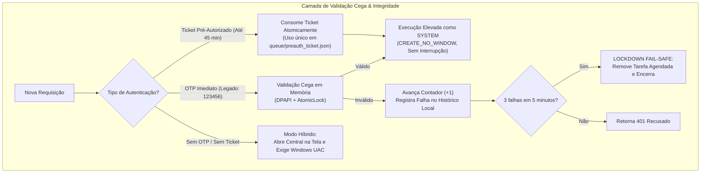

# Admin Bridge & HOTP Security System

[](LICENSE)
[](https://microsoft.com)
[-brightgreen.svg)](https://datatracker.ietf.org/doc/html/rfc4226)

Bridge administrativo com aprovação *Human-in-the-Loop*, autenticação por código de uso único baseado em contador (**HOTP - RFC 4226**), modelo de **validação cega**, isolamento estrito de memória, proteção de privilégios nativa no Windows (DPAPI em escopo de máquina local) e auditoria no fuso horário do usuário.

Projetado especialmente para permitir que agentes de IA e desenvolvedores executem tarefas administrativas com total segurança, rastreabilidade e sem concessão de acesso irrestrito.

---

## 📑 Sumário

- [Visão Geral](#-visão-geral)
- [Princípios de Segurança](#-princípios-de-segurança)
- [Canais de Execução (Pré-Autorização e Legado)](#-canais-de-execução)
- [Diagnóstico Passivo de Sincronia do Contador](#-diagnóstico-passivo-de-sincronia)
- [Isolamento NTFS e DPAPI de Máquina](#-isolamento-ntfs-e-dpapi-de-máquina)
- [Central de Gestão (Dashboard & System Tray)](#-central-de-gestão-dashboard--system-tray)
- [Operação via CLI (Linha de Comando Integral)](#-operação-via-cli-linha-de-comando-integral)
- [Como Compilar do Código-Fonte](#-como-compilar-do-código-fonte)
- [Licença](#-licença)

---

## 🎯 Visão Geral

O **Admin Bridge** atua como uma barreira de segurança (*security gate*) entre um ambiente não-elevado (como o prompt do assistente de IA ou um terminal de usuário comum) e operações que demandam permissões de Administrador do Windows.

O sistema opera em formato **standalone (executável único)**:
- Não requer instalação prévia de Python nem dependências na máquina de destino.
- Auto-extrai os componentes necessários e configura o ambiente local em `C:\Utilitario`.
- Executa como serviço protegido em segundo plano via Agendador de Tarefas do Windows sob a conta `SYSTEM` (`/ru "SYSTEM" /rl HIGHEST`).
- Funciona de forma **100% intercambiável** tanto por **Interface Gráfica (GUI na Área de Trabalho/Bandeja)** quanto por **Linha de Comando (CLI)**.
- Todos os registros de log e auditoria utilizam o **fuso horário local do computador**, sem divergências em UTC 0.

---

## 🛡️ Princípios de Segurança



### 1. Modelo de Validação Cega (Zero Display no Computador)
- O computador atua **exclusivamente como validador**. O código OTP nunca é calculado ou exibido no monitor, logs, atalhos ou menu da bandeja.
- A geração dos tokens de 6 dígitos ocorre **exclusivamente no celular** do usuário através de aplicativos autenticadores (**Aegis**, **2FAS** ou **Google Authenticator**).

### 2. Criptografia DPAPI de Máquina e Higiene de Memória
- A chave secreta de 160 bits (`secret_dpapi`) e o hash PBKDF2 da senha de recuperação são protegidos com `CRYPTPROTECT_LOCAL_MACHINE` e entropia da aplicação.
- Isso permite que o serviço rodando como `SYSTEM` execute requisições feitas por qualquer usuário do computador, mantendo a chave vinculada ao TPM/LSASS da máquina.
- Os buffers de memória são sobrescritos com zeros usando `ctypes.memset` imediatamente após o milissegundo da validação.

### 3. Assinatura de Integridade (Detecção de Adulteração Manual)
- O arquivo de configuração possui uma assinatura HMAC protegida por DPAPI (`integrity_mac`).
- Qualquer tentativa de editar o arquivo manualmente pelo Bloco de Notas ou script externo invalida a assinatura, dispara `SecurityError` e bloqueia a execução.

---

## ⚡ Canais de Execução

### Fluxo 1: Pré-Autorização no Chat (Recomendado para Tarefas Complexas)
Para evitar que o código de 6 dígitos expire enquanto o assistente planeja, analisa arquivos ou elabora scripts:
1. **Passo 1 (Pré-Autorização Imediata)**:
   ```powershell
   AdminBridge.exe preauth --otp 123456
   ```
   - Valida o código na hora, avança o contador HOTP (+1) e cria um ticket de uso único válido por até **45 minutos** (`2700s`).
2. **Passo 2 (Execução sem Pressa)**:
   ```powershell
   AdminBridge.exe run --code "powershell -Command Get-Process"
   ```
   - O serviço consome o ticket atomicamente e executa o comando em segundo plano sem exigir nova interação do usuário.

### Fluxo 2: Execução Direta em 1 Passo (Método Legado)
Se o comando já estiver pronto:
```powershell
AdminBridge.exe run --code "ipconfig /flushdns" --otp 123456
```

### Fluxo 3: Modo Híbrido sem OTP (UAC Fallback)
Se nenhum código for fornecido, a janela do Admin Bridge abre solicitando autorização física via prompt UAC do Windows.

---

## 🔍 Diagnóstico Passivo de Sincronia

Como a maioria dos aplicativos autenticadores no celular (ex: Google Authenticator) não exibe o número atual do contador, o Admin Bridge inclui um modo de diagnóstico **100% passivo**:

```powershell
AdminBridge.exe sync --otp 123456
```

- **Não avança o contador** do sistema.
- Compara o código informado com o contador atual e com uma janela de busca à frente e atrás.
- **Respostas possíveis**:
  - `100% SINCRONIZADO`: O aplicativo está exatamente no mesmo índice do computador.
  - `À FRENTE`: Informa quantas posições à frente o celular está (o sistema aceitará normalmente).
  - `ATRASADO`: Informa quantas posições o aplicativo está atrasado em relação ao computador.
  - `NÃO ENCONTRADO`: Código não pertence à chave ou está fora da janela de busca.

Também acessível na interface gráfica pelo menu de opções: **⚙️ > 🔍 Testar Sincronia do Autenticador...**

---

## 🔒 Isolamento NTFS e DPAPI de Máquina

- **Permissões em `C:\Utilitario\config`**: Restritas estritamente para `AUTORIDADE NT\SISTEMA` e `Administradores`. Usuários comuns não conseguem abrir nem inspecionar o arquivo `hotp_config.json`.
- **Permissões em `C:\Utilitario\queue` e `logs`**: Permissão de modificação para `Usuários` da máquina, garantindo que qualquer conta possa submeter requisições de execução pela ponte.

---

## 🖥️ Central de Gestão (Dashboard & System Tray)

Ao ser executado no ambiente de trabalho do usuário, o `Admin Bridge`:
1. Inicializa na bandeja do sistema ao lado do relógio do Windows (`Admin Bridge.lnk`).
2. Exibe métricas em tempo real (Contador Atual, Estado do Serviço, Disjuntor Fail-Safe).
3. Apresenta tabela com histórico de execuções com timestamps no **fuso horário local**.
4. Menu de ferramentas (⚙️) para status detalhado, teste passivo de sincronia, reset de privilégios e desinstalação completa.

---

## ⌨️ Operação via CLI (Linha de Comando Integral)

O executável `AdminBridge.exe` (ou `client.py`) suporta todos os comandos:

```powershell
# 1. Status do serviço e contador:
AdminBridge.exe status

# 2. Testar sincronia do autenticador (passivo):
AdminBridge.exe sync --otp 123456

# 3. Pré-autorizar tarefa por até 45 minutos:
AdminBridge.exe preauth --otp 123456

# 4. Executar comando elevado (usando ticket de pré-autorização):
AdminBridge.exe run --code "sfc /scannow"

# 5. Executar comando elevado imediato (legado):
AdminBridge.exe run --code "sfc /scannow" --otp 123456

# 6. Histórico recente de auditoria:
AdminBridge.exe history

# 7. Resetar privilégios e destruir segredo:
AdminBridge.exe reset

# 8. Desinstalar utilitário completamente:
AdminBridge.exe uninstall --force
```

---

## 🛠️ Como Compilar do Código-Fonte

### Pré-requisitos
- Python 3.10+ no Windows.
- Dependências: `pip install PyQt6 qrcode pillow PyInstaller`

### Script de Build
Execute na raiz do repositório:
```powershell
.\build.bat
```
O script roda automaticamente os 10 testes de segurança (`test_security_rules.py`), compila o executável standalone (`dist\AdminBridge.exe`) e atualiza `C:\Utilitario` e a Área de Trabalho.

---

## 📄 Licença

Disponibilizado sob a licença **PolyForm Noncommercial License 1.0.0**. Consulte o arquivo [LICENSE](LICENSE) para detalhes completos.
