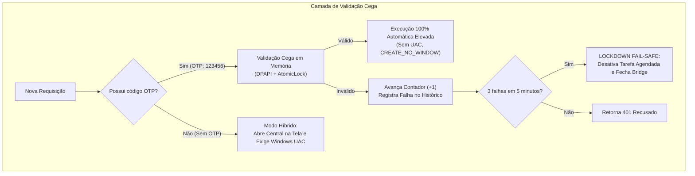

# Antigravity Admin Bridge & HOTP Security System

[](LICENSE)
[](https://microsoft.com)
[-brightgreen.svg)](https://datatracker.ietf.org/doc/html/rfc4226)

Bridge administrativo autônomo com aprovação *Human-in-the-Loop*, autenticação por código de uso único baseado em contador (**HOTP - RFC 4226**), modelo de **validação cega**, isolamento estrito de memória e proteção de privilégios nativa no Windows.

Projetado especialmente para permitir que agentes de IA e desenvolvedores executem tarefas administrativas com total segurança, rastreabilidade e sem concessão de acesso irrestrito.

---

## 📑 Sumário

- [Visão Geral](#-visão-geral)
- [Princípios de Segurança](#-princípios-de-segurança)
- [Modo Híbrido de Execução](#-modo-híbrido-de-execução)
- [Primeiro Aprovisionamento (Passo a Passo)](#-primeiro-aprovisionamento-passo-a-passo)
- [Estrutura de Comunicação (IPC via Fila)](#-estrutura-de-comunicação-ipc-via-fila)
- [Comandos CLI e Operações](#-comandos-cli-e-operações)
- [Como Compilar do Código-Fonte](#-como-compilar-do-código-fonte)
- [Licença](#-licença)

---

## 🎯 Visão Geral

O **Antigravity Admin Bridge** atua como uma barreira de segurança (*security gate*) entre um ambiente não-elevado (como o prompt do assistente de IA ou um terminal comum) e operações que demandam permissões de Administrador do Windows.

O sistema opera em formato **standalone (executável único)**:
- Não requer instalação prévia de Python nem dependências na máquina de destino.
- Auto-extrai os componentes necessários e configura o ambiente local em `C:\Utilitario`.
- Mantém um serviço em segundo plano via Agendador de Tarefas do Windows (`schtasks`) com privilégios elevados.
- Comunica-se de forma assíncrona por meio de arquivos JSON em fila protegida por ACLs NTFS.

---

## 🛡️ Princípios de Segurança



### 1. Modelo de Validação Cega (Zero Display no Computador)
- O computador atua **exclusivamente como validador**. O código OTP nunca é calculado ou exibido no monitor, logs, atalhos ou menu da bandeja.
- A geração dos tokens de 6 dígitos ocorre **exclusivamente no celular** do usuário através de aplicativos autenticadores (**Aegis**, **2FAS** ou **Google Authenticator**).

### 2. Higiene Estrita de Memória & Zero Vestígios em Disco
- A chave secreta de 160 bits e a URI `otpauth://hotp/...` são criadas **estritamente em memória RAM**.
- É **proibido salvar o QR Code em disco**: a imagem é renderizada temporariamente em buffer `io.BytesIO` e exibida no diálogo gráfico. Ao fechar a janela, o buffer é sobrescrito com zeros (`memset`) e destruído pelo garbage collector (`gc.collect()`).
- Em repouso, a chave é cifrada pela **Windows DPAPI** (`CryptProtectData`) atrelada ao hardware/TPM.

### 3. Permissões NTFS Restritivas
- Ao inicializar, o diretório `C:\Utilitario` e o arquivo `hotp_config.json` têm a herança de permissões removida (`/inheritance:r`) via comando nativo `icacls`.
- Acesso concedido exclusivamente a:
  - `AUTORIDADE NT\SISTEMA (SYSTEM)`: Controle Total `(F)`
  - `BUILTIN\Administradores`: Controle Total `(F)`
  - Usuário ativo autenticado: Modificação `(M)`

### 4. Atomicidade e Avanço Obrigatório do Contador
- Prevenção contra *race conditions* usando bloqueio atômico com Windows Named Mutex (`Local\AntigravityHOTPMutex`) e bloqueio de arquivo (`hotp.lock`).
- **Avanço Monótono Estrito**: O contador consome um incremento **obrigatoriamente tanto em caso de SUCESSO quanto em caso de ERRO** (código inválido, replay ou erro de formato). Isso neutraliza ataques de enumeração e força bruta.

### 5. Disjuntor de Segurança (Fail-Safe Lockdown)
- Se ocorrerem **3 falhas consecutivas de validação em menos de 5 minutos (300s)**, o sistema aciona o modo de bloqueio:
  1. A tarefa agendada elevada é desativada imediatamente (`schtasks /change /tn AntigravityAdminBridge /disable`).
  2. O processo `AntigravityBridge.exe` é finalizado.
  3. Qualquer execução subsequente volta a exigir aprovação física interativa via Windows UAC.

### 6. Reset Autenticado Sem Credenciais Estáticas
- Nenhuma senha pré-definida existe no código.
- O reset de chave exige simultaneamente:
  - **Comprovação de Presença Física**: Digitação de um código de desafio efêmero (`PHYS-XXXXXX`) exibido na tela no momento do reset.
  - **Palavra-passe de Recuperação**: Validada com **PBKDF2-HMAC-SHA256** (600.000 iterações + salt de 128 bits dinâmico).

---

## ⚡ Modo Híbrido de Execução

| Cenário | Comportamento do Sistema | Nível de Intervenção |
| :--- | :--- | :--- |
| **Requisição com OTP válido** (`OTP: 123456`) | Valida atomicamente o código do celular, avança o contador e executa o comando em segundo plano silenciosamente (`CREATE_NO_WINDOW`) com privilégios elevados. | **100% Automático** (sem pop-ups, sem prompt UAC). |
| **Requisição sem OTP** | Abre a Central de Aprovação no monitor exibindo o script com badge `UAC REQUERIDO`. O usuário audita o código e clica em "Aprovar & Executar via UAC", disparando o diálogo nativo do Windows UAC. | **Manual / Auditoria Física**. |

---

## 📱 Primeiro Aprovisionamento (Passo a Passo)

1. Execute o binário `AntigravityBridge.exe` (ou dê dois cliques no atalho `Configurar Antigravity Bridge` na Área de Trabalho).
2. Se necessário, o Windows solicitará elevação de privilégios UAC.
3. A janela de **Assistente de Provisionamento HOTP** será aberta na tela:
   - Digite sua **Palavra-passe de Recuperação** pessoal (mínimo de 8 caracteres) e confirme-a.
   - Clique em **"Gerar Chave e Exibir QR Code na Tela"**.
4. No celular, abra seu aplicativo autenticador (**Aegis**, **2FAS** ou **Google Authenticator**):
   - Toque em **+** $\rightarrow$ **Escanear código QR**.
   - Aponte a câmera para o QR Code exibido na janela.
   - *(Opcional)* Se preferir cadastro manual, copie a chave Base32 informada e configure como **Baseado em contador (HOTP)**, **Contador inicial: 0**, **6 dígitos**.
5. Clique em **"Concluir Pareamento • Já Escaneei no Celular"**.
6. O instalador grava as configurações protegidas via DPAPI, aplica permissões NTFS, registra a tarefa no Agendador do Windows (`schtasks`) e inicia a Central em segundo plano na bandeja do sistema.

---

## 🔄 Estrutura de Comunicação (IPC via Fila)

O utilitário monitora diretórios locais em `C:\Utilitario\queue`:

### 1. Envio de Requisição (`queue/requests/<UUID>.json`)
```json
{
  "id": "c1f7b82e-9d22-482a-a9a7-8f5b8214fa31",
  "title": "Limpeza de Cache DNS e Rede",
  "description": "Renova concessões DHCP e limpa cache DNS local",
  "script_type": "cmd",
  "code": "ipconfig /flushdns && ipconfig /renew",
  "otp": "482910",
  "caller": {
    "pid": 14208,
    "exe": "python.exe",
    "script": "client.py",
    "user": "Administrador"
  },
  "created_at": "2026-10-10T22:30:00.000Z",
  "status": "pending"
}
```

### 2. Retorno de Resposta (`queue/responses/<UUID>.json`)
```json
{
  "id": "c1f7b82e-9d22-482a-a9a7-8f5b8214fa31",
  "status": "approved",
  "exit_code": 0,
  "output": "Configuração de IP do Windows\n\nLiberação do Cache do DNS Resolver bem-sucedida.",
  "completed_at": "2026-10-10T22:30:01.450Z"
}
```

### 3. Heartbeat do Serviço (`queue/heartbeat.json`)
```json
{
  "pid": 28410,
  "timestamp": 1791681001.25,
  "status": "idle"
}
```

---

## 💻 Comandos CLI e Operações

O próprio executável `AntigravityBridge.exe` funciona tanto como daemon de serviço quanto como cliente CLI:

### 1. Consultar Posição do Contador (Sem Avançar)
Consulta metadados sem calcular nem queimar nenhum código:
```powershell
C:\Utilitario\AntigravityBridge.exe --status
```

### 2. Redefinir Chave / Parear Novo Autenticador (Reset)
Abre a interface de reset exigindo presença física e senha atual:
```powershell
C:\Utilitario\AntigravityBridge.exe --reset
```

### 3. Enviar Comando via Linha de Comando (Cliente Integrado)
```powershell
C:\Utilitario\AntigravityBridge.exe run `
  --title "Verificar Integridade do Sistema" `
  --description "Executa verificação sfc" `
  --type cmd `
  --code "sfc /scannow" `
  --otp 123456 `
  --timeout 180
```

### 4. Verificar se a Central está Ativa
```powershell
C:\Utilitario\AntigravityBridge.exe status
```

---

## 🛠️ Como Compilar do Código-Fonte

### Pré-requisitos
- Python 3.10 ou superior no Windows.
- Dependências Python:
  ```powershell
  pip install PyQt6 qrcode pillow PyInstaller
  ```

### Comando de Build Consolidado (Onefile com UAC Admin)
Execute no diretório raiz do projeto:
```powershell
python -m PyInstaller `
  --uac-admin `
  --noconsole `
  --onefile `
  --icon="icon.ico" `
  --name="AntigravityBridge" `
  --distpath="C:\Utilitario" `
  --workpath="C:\Utilitario\build" `
  --specpath="C:\Utilitario" `
  --exclude-module=torch `
  --exclude-module=torchvision `
  --exclude-module=cv2 `
  --exclude-module=scipy `
  --exclude-module=pandas `
  app.py
```

O binário final autônomo será gerado em `C:\Utilitario\AntigravityBridge.exe`.

---

## 📄 Licença

Este software é disponibilizado sob a licença **PolyForm Noncommercial License 1.0.0**.

- **Uso e Modificação**: Você tem total permissão para utilizar, inspecionar, estudar, modificar e distribuir o software para **fins pessoais, acadêmicos, educativos e não-comerciais**.
- **Proibição Comercial**: É expressamente proibido qualquer uso, redistribuição ou exploração deste software com finalidade comercial, cobrança de taxas, integração em serviços corporativos pagos ou geração de receitas.

Consulte o arquivo [LICENSE](LICENSE) para ler os termos jurídicos completos.
